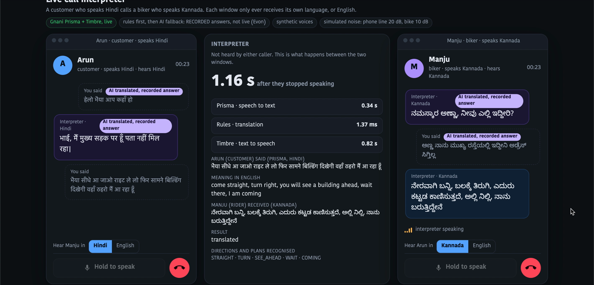
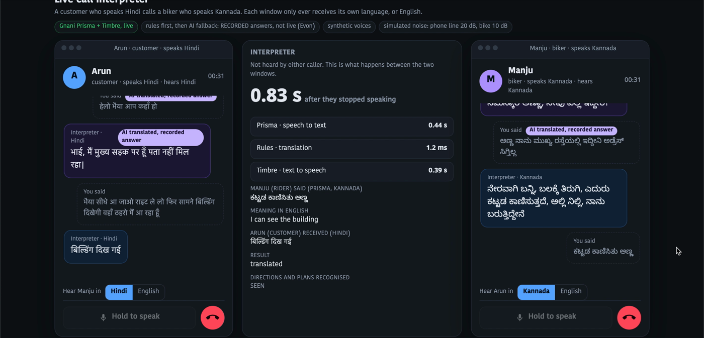

# Solution pitch: Landmark Chain

**A live call interpreter for delivery riders and customers who do not share a language.** A prototype for the Great Indian AI Internship Challenge (Gnani AI). Synthetic voices only.

## The problem

Addresses are often given as landmarks ("behind the temple, blue gate") over a phone call, and the rider and the customer often speak different languages. The call that should end the delivery turns into minutes of "what does that mean?". (We did not measure how often this causes a failed delivery, so we make no such claim.)

## The solution

Each person has their own phone-style window. The customer speaks Hindi, Hinglish or English; the rider hears Kannada (or English) and replies in their own language. **Each window only ever receives its own language.**

```
voice -> Gnani Prisma (speech to text) -> rules -> Gnani Timbre (text to speech) -> the other window only
```

The translation step is **rule-based**: fixed tables for landmarks, colours, lane numbers, sides and yes/no, plus a closed grammar of seven direction clauses. It does not guess: **whatever it cannot translate, it says so out loud**, in both languages, so nobody is sent the wrong way by a plausible mistake. An optional AI fallback (Gnani's open-weight Evon) handles casual sentences, behind a fixed check, and every such turn is labelled on screen.


*A scripted call between synthetic voices. The customer's Hindi ("come straight, turn right, you will see a building ahead, wait there, I am coming") reaches the rider in Kannada 1.16 s after the speaker stopped. The middle panel is the operator view: each stage's time and the English meaning. The two lines labelled AI are recorded answers from the optional AI fallback.*


*The rider replies in Kannada ("I can see the building") and the customer hears it in Hindi, ready 0.83 s after the rider stopped speaking.*

## What was built

- Two caller windows with an operator view, a scripted call, and a microphone mode.
- Three language pairs through one pipeline: Hindi to Kannada, Kannada to Hindi, English to Hindi.
- 79 Hinglish edge cases with the correct outcome written down first, enforced by tests; every number in the documents is generated from saved result files.

## Next steps

A native Kannada speaker reviews every Kannada string; a trial with real riders and customers; streaming translation; more directions and landmark types.

## Run it

`pip install -r requirements.txt`, put `GNANI_API_KEY` in `.env`, then `python live_call.py` and open `http://127.0.0.1:8770/`. Details and all results: `README.md` and `SUBMISSION.md`.
